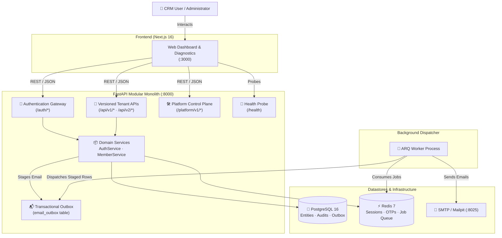

# 🏢 Enterprise CRM — Product & Technology Overview

[](https://fastapi.tiangolo.com/)
[](https://nextjs.org/)
[](https://www.postgresql.org/)
[](https://redis.io/)

This document introduces the Enterprise CRM product context, high-level system boundaries, and technology decisions.

---

## 📑 Table of Contents

- [Product Context](#-product-context)
- [High-Level System Context](#-high-level-system-context)
- [Technology Stack Matrix](#-technology-stack-matrix)
- [Repository Organization](#-repository-organization)
- [Authoritative Source of Truth](#-authoritative-source-of-truth)
- [Next Steps & Navigation](#-next-steps--navigation)

---

## 🎯 Product Context

Enterprise CRM is a secure, multi-tenant B2B SaaS platform engineered for organizational identity management, strict tenant boundary enforcement, and transactional customer relationship operations.

### Key Capabilities

1. **Multi-Tenant Identity & Access Management (IAM)**
   - Global user identities decoupled from tenant memberships.
   - Dual-role hierarchy: platform-wide superadmins and customizable tenant-specific roles.
   - Canonical capability permissions formatted as `module.resource.action`.
2. **Enterprise Authentication & Security**
   - OWASP-grade Argon2id password hashing.
   - Time-limited JWT access tokens with rotating opaque refresh tokens.
   - Multi-factor authentication (email OTP) and account-enumeration-proof password resets.
3. **Transactional Background Processing**
   - Zero-email-loss transactional outbox staged in PostgreSQL and delivered via Redis + ARQ workers.
4. **Auditability & Compliance**
   - Immutable audit logs for all role assignments, grants, and revocations for SOC2 / ISO readiness.

---

## 🏛️ High-Level System Context



---

## 📊 Technology Stack Matrix

| Area | Technology | Version / Specification | Rationale & Responsibility |
|---|---|---|---|
| **Backend Runtime** | Python | `>=3.12` | Modern typing syntax, performance enhancements, and standard library features |
| **API Framework** | FastAPI | `0.115+` | High throughput, asynchronous I/O, automatic OpenAPI / Swagger generation |
| **Data Validation** | Pydantic v2 | `2.8+` | Fast C-core serialization, strict payload validation, and typed response models |
| **Database ORM** | SQLAlchemy | `2.0+ (Async)` | Type-safe declarative mappings (`Mapped[]`), async connection pooling |
| **Relational Database** | PostgreSQL | `16 (pgvector)` | Tenant-isolated relational persistence, JSONB, and partial indexes |
| **Database Migrations** | Alembic | `1.20+` | Controlled, forward/backward schema migration tracking |
| **Cache & Queue** | Redis | `7 (Alpine)` | Fast session store, rate-limiting counters, and ARQ queue broker |
| **Job Queue** | ARQ | `0.28+` | Light async Redis-backed job processing for background email workers |
| **Password Hashing** | Argon2id | via `argon2-cffi` | OWASP recommended memory-hard password derivation against GPU attacks |
| **JWT Library** | PyJWT | `2.15+` | Cryptographic HMAC signing and verification of claims |
| **Email Delivery** | aiosmtplib | `3.0+` | Non-blocking async SMTP client |
| **Templates** | Jinja2 | `3.1+` | Securely auto-escaped HTML email templating |
| **Frontend Framework** | Next.js | `16.4.5` (App Router) | Server-side rendering, streaming, and modern React 19 architecture |
| **Frontend Language** | TypeScript | `5.x` | Strict compile-time safety across client-side components |
| **Styling** | Tailwind CSS | `4.x` | Modern utility-first responsive stylesheet architecture |
| **Dependency Manager** | Astral `uv` | Latest | Sub-second deterministic Python package resolution and environment management |
| **Container Engine** | Docker Compose | Compose v2 | Reproducible local developer environment for PostgreSQL, Redis, Mailpit |

---

## 📁 Repository Organization

```text
enterprise-crm/
├── README.md               # Primary GitHub repository overview and quick start
├── AGENTS.md               # Engineering guidelines & security instructions for AI agents
├── compose.yaml            # Local Docker infrastructure (PostgreSQL, Redis, Mailpit, pgweb)
├── backend/                # FastAPI application, ORM models, migrations, and scripts
│   ├── README.md           # Backend service documentation
│   ├── main.py             # FastAPI application entry point
│   ├── pyproject.toml      # Python dependencies and build system configuration
│   ├── alembic/            # Database schema migration revisions
│   ├── scripts/seed/       # Initial setup seed commands (RBAC, masters, demo users)
│   └── app/                # Application modules (api, core, models, schemas, services, workers)
├── frontend/               # Next.js 16 user interface
│   ├── README.md           # Frontend application documentation
│   ├── package.json        # Node.js dependencies and scripts
│   └── src/app/            # App Router pages and layout components
└── docs/                   # Topic-organized technical documentation
    ├── README.md           # Documentation hub and navigation map
    ├── 00-overview/        # Product, technology, and architecture context
    ├── 01-architecture/    # System design, tenancy, and ADRs
    ├── 02-setup/           # Local development setup and developer cheat sheet
    ├── 03-modules/         # Deep dives on auth, IAM, and email
    ├── 04-database/        # Schema models, migrations, and seed data
    └── 05-ai-and-standards/# Instructions for AI coding assistants
```

---

## ⚖️ Authoritative Source of Truth

The active codebase and database migrations define the current behavior of the system. Repository-wide engineering standards are maintained in [`AGENTS.md`](../../AGENTS.md).

---

## 🧭 Next Steps & Navigation

- 🏗️ **Architecture:** [System Architecture and Module Map](../01-architecture/system-overview.md)
- 🔐 **Tenancy & RBAC:** [RBAC and Tenant Architecture](../01-architecture/rbac-and-tenancy.md)
- 🚀 **Getting Started:** [Local Development Guide](../02-setup/local-development.md)
- 💻 **Commands:** [Developer Command Cheat Sheet](../02-setup/developer-commands.md)
