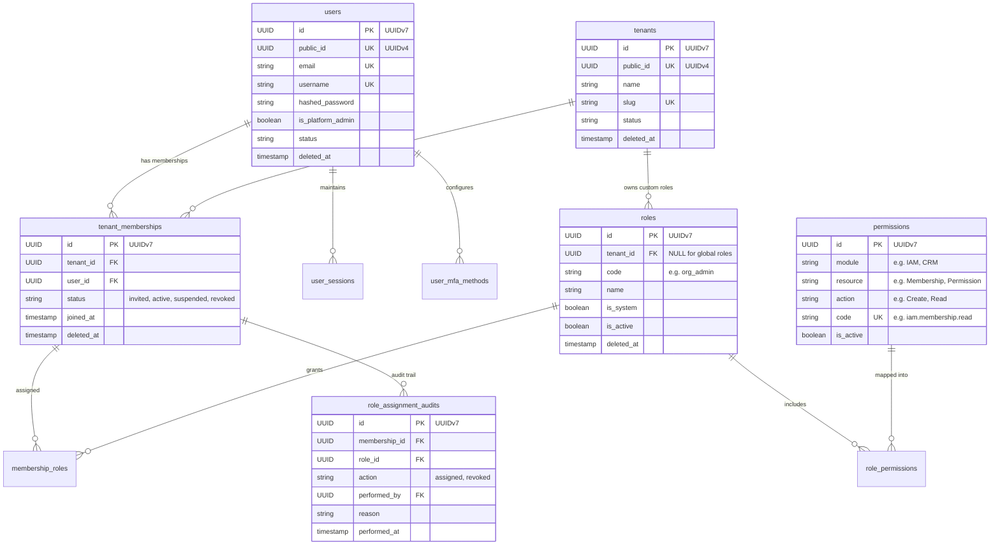
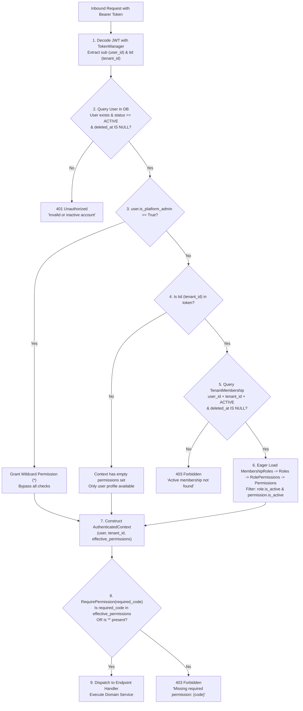
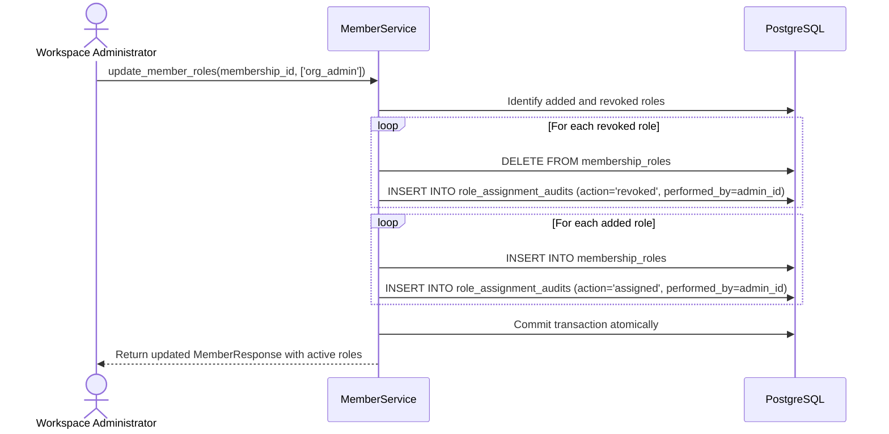

# RBAC and Tenant Architecture

This specification details the foundational Multi-Tenant Identity, Role-Based Access Control (RBAC), and authorization resolution model implemented in the backend.

---

## 📑 Table of Contents

- [Entity Relationship Diagram](#-entity-relationship-diagram)
- [Data Model & Scope Semantics](#-data-model--scope-semantics)
- [Request Authorization Flow](#-request-authorization-flow)
- [Predefined System Roles & Permissions Matrix](#-predefined-system-roles--permissions-matrix)
- [Audit & Compliance Logging](#-audit--compliance-logging)
- [Current Implementation Boundaries & Gaps](#-current-implementation-boundaries--gaps)
- [Related Documentation](#-related-documentation)

---

## 🏛️ Entity Relationship Diagram

---

## 📊 Data Model & Scope Semantics

1. **Users (`users`)**:
   Global identities that exist independently of organizations. A user can belong to zero, one, or many tenants.
2. **Tenants (`tenants`)**:
   Customer workspaces / organizations. Isolated from each other with explicit `tenant_id` boundaries.
3. **Tenant Memberships (`tenant_memberships`)**:
   The authoritative link between a user and a tenant. Tracks the lifecycle status (`invited`, `active`, `suspended`, `revoked`, `removed`).
4. **Roles (`roles`)**:
   - **Global System Roles (`tenant_id IS NULL`)**: Built-in platform roles defined across all tenants (e.g. `platform_admin`, `org_owner`, `org_admin`, `member`, `viewer`).
   - **Custom Tenant Roles (`tenant_id == UUID`)**: Scoped to the specific tenant and cannot be viewed or assigned by other tenants.
5. **Permissions (`permissions`)**:
   Global atomic capability catalog formatted as canonical dot-separated codes (`module.resource.action`).
6. **Role Assignment Audits (`role_assignment_audits`)**:
   Append-only immutable record of every role assignment and revocation with actor ID and timestamp for SOC2 / ISO compliance.

---

## 🔄 Request Authorization Flow

Every protected endpoint resolves permissions using `get_current_context` and `RequirePermission` in `backend/app/api/dependencies/auth.py`:

---

## 📋 Predefined System Roles & Permissions Matrix

Declared in `backend/app/core/constants.py` and synchronized by `backend/scripts/seed_rbac.py`:

| Role Code | Role Name | System? | Tenant Scope | Key Permissions |
|---|---|---|---|---|
| `platform_admin` | Platform Administrator | Yes | Global (`tenant_id IS NULL`) | `*` (Wildcard cross-tenant operator) |
| `org_owner` | Organization Owner | Yes | Global template | Full workspace authority: user/tenant/membership/role CRUD, session & audit read |
| `org_admin` | Organization Administrator | Yes | Global template | Day-to-day administration: membership CRUD, role read & assignment, audit read |
| `member` | Member | Yes | Global template | Standard user: `iam.user.read/update`, `iam.tenant.read`, `iam.membership.read`, `iam.mfa.manage` |
| `viewer` | Viewer | Yes | Global template | Read-only access: `iam.tenant.read`, `iam.membership.read` |

---

## 🔍 Audit & Compliance Logging

Any role assignment or revocation automatically inserts an audit row into `role_assignment_audits` inside the same database transaction:

---

## ⚠️ Current Implementation Boundaries & Gaps

1. **Partial Repository Adoption**:
   `app/repositories/` contains member and platform repositories, but `MemberService` still executes SQLAlchemy queries directly on `AsyncSession`.
2. **Compatibility Dependency Re-export**:
   `backend/app/api/deps.py` re-exports auth and database dependencies for existing imports. New code should import from `backend/app/api/dependencies/auth.py` or `database.py`.
3. **TenantMembership Soft-Delete Uniqueness**:
   `TenantMembership` enforces `UniqueConstraint("tenant_id", "user_id")` unconditionally (not filtered with `WHERE deleted_at IS NULL`). Re-inviting a user whose previous membership was soft-deleted requires handling the existing row.
4. **Role Code Partial Indexes**:
   Unique indexes on `roles.code` partition by tenant scope (`WHERE tenant_id IS NULL` vs `WHERE tenant_id IS NOT NULL`), but do not include a `deleted_at IS NULL` predicate.
5. **No Automatic Startup Seeding**:
   Permissions and roles must be seeded by executing `uv run python scripts/seed_rbac.py` manually after schema migrations.

---

## 📖 Related Documentation

- [System Architecture & Module Map](system-overview.md)
- [IAM & RBAC Endpoint Guide](../03-modules/iam-rbac.md)
- [Database Models & Migrations](../04-database/database-and-migrations.md)
- [RBAC Seed Data Status](../04-database/seed-data.md)
- [Engineering Standards & AI Agent Guidelines](../../AGENTS.md)
