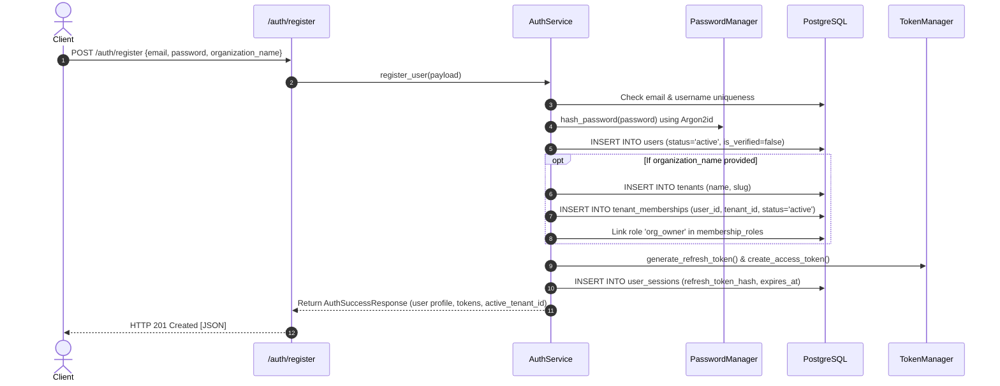
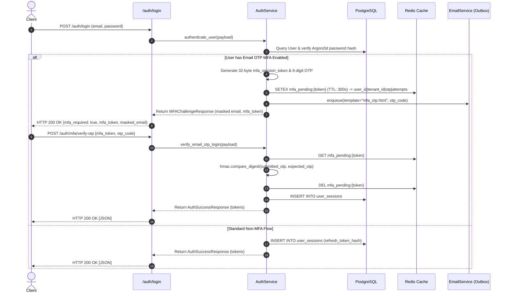
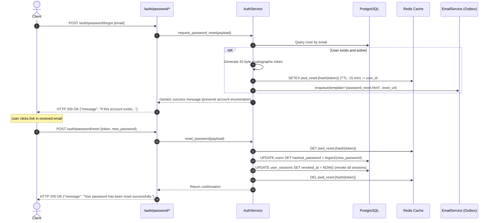

# Identity and Authentication Specification

This document details the authentication and identity mechanisms implemented in `backend/app/api/auth/router.py`, `backend/app/services/auth_service.py`, and `backend/app/core/security.py`.

---

## 📑 Table of Contents

- [Scope & Active Routes](#-scope--active-routes)
- [Registration & Tenant Provisioning Flow](#-registration--tenant-provisioning-flow)
- [Login & Email OTP MFA Challenge Flow](#-login--email-otp-mfa-challenge-flow)
- [Password Reset Flow](#-password-reset-flow)
- [Session Token Rotation & Workspace Switching](#-session-token-rotation--workspace-switching)
- [Security & Cryptographic Standards](#-security--cryptographic-standards)
- [Current Implementation Boundaries & Gaps](#-current-implementation-boundaries--gaps)
- [Related Code & References](#-related-code--references)

---

## 🌐 Scope & Active Routes

The active authentication router is `backend/app/api/auth/router.py`, mounted at `/auth` in `backend/main.py`.

| Method | Path | Summary | Auth Required |
|---|---|---|---|
| `POST` | `/auth/register` | Create user; optionally provision initial tenant & assign owner role | None |
| `POST` | `/auth/login` | Authenticate credentials; returns tokens or email-MFA challenge | None |
| `POST` | `/auth/refresh` | Rotate refresh token and issue new JWT access token | None |
| `POST` | `/auth/logout` | Revoke active user session | None |
| `GET` | `/auth/me` | Return profile of currently authenticated user | Bearer Token |
| `GET` | `/auth/workspaces` | List active workspaces where user holds membership | Bearer Token |
| `POST` | `/auth/switch-workspace` | Switch active workspace context and issue tenant-scoped JWT | Bearer Token |
| `POST` | `/auth/password/forgot` | Request password reset email via transactional outbox | None |
| `POST` | `/auth/password/reset` | Set new password using token and revoke all active sessions | None |
| `POST` | `/auth/mfa/verify-otp` | Verify 6-digit email OTP to complete login | None |
| `POST` | `/auth/mfa/email/toggle` | Enable or disable email OTP MFA (requires password) | Bearer Token |

---

## 📝 Registration & Tenant Provisioning Flow

---

## 🔐 Login & Email OTP MFA Challenge Flow

---

## 🔑 Password Reset Flow

---

## 🔄 Session Token Rotation & Workspace Switching

1. **Access Tokens**: Short-lived JWTs signed with HMAC-SHA256 containing:
   - `sub`: Internal user UUIDv7
   - `puid`: Public user UUIDv4
   - `tid`: Active workspace tenant UUIDv7 (optional)
   - `jti`: Cryptographically random nonce guarding against replay
   - Configured lifespan: 15 minutes.
2. **Refresh Tokens**: Opaque 512-bit URL-safe random strings. Only the SHA-256 digest is stored in `user_sessions`. Rotating the refresh token updates `refresh_token_hash` and invalidates the previous token to prevent replay attacks.
3. **Workspace Switching (`POST /auth/switch-workspace`)**:
   - Validates active membership in target workspace.
   - Rotates active session and updates its `tenant_id`.
   - Mints and returns a new access token scoped with the target `tid`.

---

## 🛡️ Security & Cryptographic Standards

- **Password Hashing**: OWASP-recommended **Argon2id** (`time_cost=3`, `memory_cost=65536` KiB, `parallelism=4`, `salt_len=16`).
- **Timing Attacks**: All OTP code comparisons use `hmac.compare_digest`.
- **Brute-Force Guard**: Failed OTP attempts increment counter in Redis; rejected after 5 attempts with `HTTP 429 Too Many Requests`.
- **Account Enumeration Defense**: Both registration and password-reset endpoints return generic confirmations or structured error codes.

---

## ⚠️ Current Implementation Boundaries & Gaps

- Domain exceptions (`EntityNotFoundException`, `EntityConflictException`, `BusinessRuleViolationException`, `PermissionDeniedException`, `AuthenticationException`, `RateLimitExceededException`) are now used in `AuthService`, decoupling business logic from FastAPI transport handlers.
- A separate database repository layer is planned for future phases to abstract SQLAlchemy session queries from services.

---

## 📖 Related Code & References

- Router: [`backend/app/api/auth/router.py`](../../backend/app/api/auth/router.py)
- Service: [`backend/app/services/auth_service.py`](../../backend/app/services/auth_service.py)
- Security Helpers: [`backend/app/core/security.py`](../../backend/app/core/security.py)
- Models: [`user.py`](../../backend/app/models/user.py), [`user_session.py`](../../backend/app/models/user_session.py), [`user_mfa_method.py`](../../backend/app/models/user_mfa_method.py)
- Email System: [Email Outbox and Background Worker](email-and-background-work.md)
