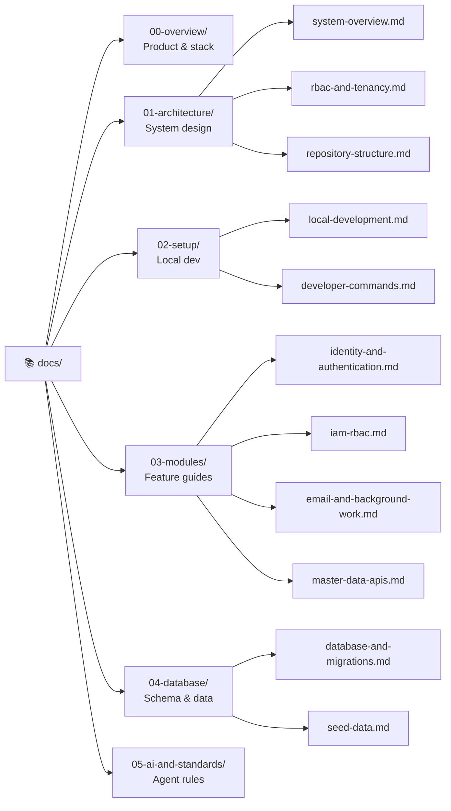
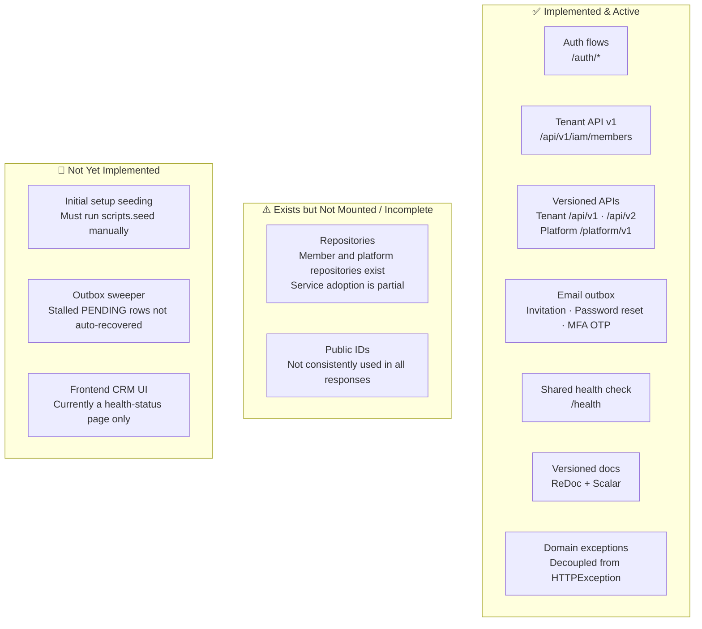

# Enterprise CRM — Documentation Hub

> Documentation is organized by topic and always reflects the **inspected implementation**. Where the intended architecture differs from what is currently built, guides call out the gap explicitly.

---

## 🗺️ Documentation Map

---

## 00 — Overview

| Document | Description |
|---|---|
| [Product and technology overview](00-overview/README.md) | What is built, the full tech stack, and current implementation status |

---

## 01 — Architecture

| Document | Description |
|---|---|
| [System architecture and module map](01-architecture/system-overview.md) | Repository layout, active route topology, request/data flow, and known gaps |
| [RBAC and tenant architecture](01-architecture/rbac-and-tenancy.md) | Role model, permission resolution flow, and tenancy boundaries |
| [ADR-001: Repository structure](01-architecture/repository-structure.md) | Architecture decision record for the monorepo layout |

---

## 02 — Setup

| Document | Description |
|---|---|
| [Local development and configuration](02-setup/local-development.md) | Infrastructure services, environment variables, and application processes |
| [Developer command cheat sheet](02-setup/developer-commands.md) | All `uv`, `npm`, `docker compose`, migration, seed, and worker commands |

---

## 03 — Modules

| Document | Description |
|---|---|
| [Identity and authentication](03-modules/identity-and-authentication.md) | Registration, login, MFA, password reset, session management |
| [IAM and RBAC implementation](03-modules/iam-rbac.md) | Member management, role assignment, audit trail |
| [Core and CRM master-data APIs](03-modules/master-data-apis.md) | Tenant CRUD and platform-managed global reference catalogs |
| [Email outbox and background worker](03-modules/email-and-background-work.md) | Transactional email system, ARQ worker, delivery guarantees |

---

## 04 — Database

| Document | Description |
|---|---|
| [Database model and migrations](04-database/database-and-migrations.md) | Persisted models, Alembic migration history, identifier and lifecycle patterns |
| [Seed data and RBAC seeder](04-database/seed-data.md) | Initial setup seed package, demo accounts, and RBAC-only command |

---

## 05 — AI and Standards

| Document | Description |
|---|---|
| [AI agent instructions](05-ai-and-standards/README.md) | Agent entry points and links to engineering standards |

---

## 📌 Current Implementation Notes

The backend is an early-stage modular monolith. See [system architecture](01-architecture/system-overview.md) for the verified route topology and all known gaps.
